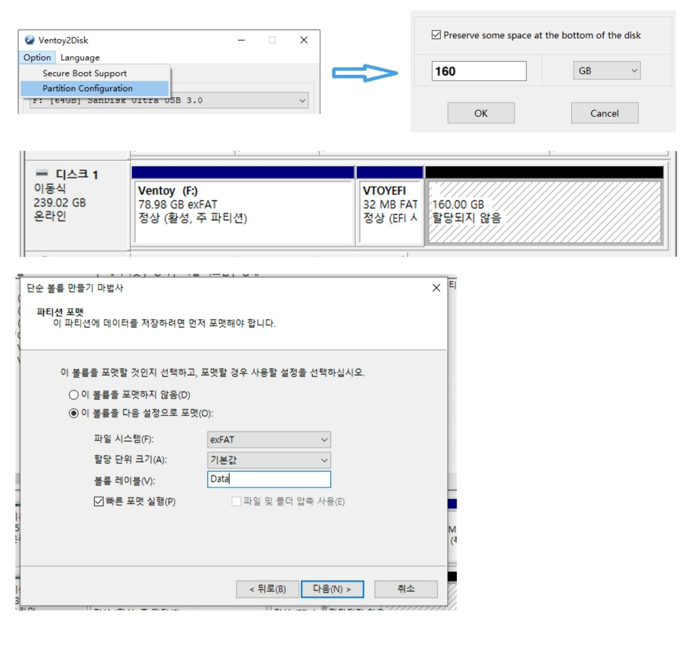

# Part 1. 이미지 — 미리 만들어 둔 서버 {#part-1}

> 담당 랩 [실습①](labs/lab-01.qmd)·[실습②](labs/lab-02.qmd). 랩에서 손으로 만든 뒤, 여기서 **왜 그렇게 하는지**를 본다.

이 파트를 관통하는 생애주기는 한 줄입니다.

```{mermaid}
flowchart LR
  A["받기"] --> B["탐색"] --> C["패치"] --> D["일반화"] --> E["배포"] --> F["복구"]
```

각 절은 이 고리의 한 칸을 설명합니다. 마지막 두 절(1.8·1.9)은 "이미지 바깥"의 재현성(reproducibility, 같은 입력으로 같은 결과를 다시 만들 수 있는 성질)과 운반을 다룹니다.

## 1.1 ISO 설치 대신 이미지 — 골든 이미지와 선언형 운영 {#1-1-golden-image}

**멘탈모델:** 서버는 ‘설치하는 것’이 아니라 ‘만들어 둔 이미지 파일을 디스크에 복원하는 것’이다.

ISO(설치 CD·DVD의 내용을 파일 하나에 담은 디스크 이미지)로 설치하면 마법사에서 누른 선택(파티션·패키지·계정)이 사람의 손과 기억에 남습니다. 같은 서버를 두 번 만들면 두 번 다르고, 왜 다른지 기록도 없습니다. 반대로 **골든 이미지**(golden image, 표준으로 삼아 복제해 쓰는 기준 디스크 이미지)는 "이 상태가 정답"인 결과물을 파일 하나로 가지고 있습니다. 바꾸고 싶으면 파일을 고치고, 다시 만들고 싶으면 그 파일을 디스크에 기록합니다.

여기서 운영 방식이 바뀝니다. 절차(명령형, imperative: "이것을 설치하고 저것을 눌러라")를 나열하는 대신 **원하는 상태(선언형, declarative)** 를 정의하고, 그 상태를 반복해서 찍어 냅니다. [실습①](labs/lab-01.qmd)의 `virt-customize` 명령 한 묶음이 그 선언에 해당합니다. 스크립트는 git에 두고, 비밀(비번)만 밖에 둡니다.

이점은 속도보다 **감사 가능성**(auditability, 누가 언제 무엇을 바꿨는지 나중에 확인할 수 있는 성질)입니다. "이 서버에 무엇이 들어 있나"가 사람의 기억이 아니라 파일과 스크립트에 있으면, 사고가 났을 때 되돌릴 기준점이 있습니다. 복구([1.5](#1-5-deploy))가 분 단위로 가능한 것도 같은 이유입니다.

더 깊이: [cloud-init 문서](https://cloudinit.readthedocs.io/) (첫 부팅 때 선언을 적용하는 표준 방식), [Ubuntu cloud images](https://cloud-images.ubuntu.com/).

## 1.2 디스크 이미지 형식 {#1-2-image-formats}

디스크 이미지는 가상 디스크 한 장을 파일 하나에 담은 것입니다. 디스크 안의 내용이 같아도 담는 형식에 따라 파일 크기, 읽고 쓰는 속도, 쓸 수 있는 기능이 달라집니다. 이 절에서는 Ubuntu 26.04 클라우드 이미지를 직접 받아 형식을 확인하고, raw 형식으로 바꿔 보고, 두 가지 클론 방식을 비교하면서 그 차이를 봅니다.

::: {.callout-note title="실행 환경"}
이 절의 출력은 Ubuntu 24.04의 `qemu-utils` 8.2.2로, 2026년 10월 16일에 빌드된 Ubuntu 26.04 클라우드 이미지를 다룬 결과입니다. 파일 크기와 걸린 시간은 이미지 빌드와 저장 장치에 따라 달라집니다. 출력에서 이 절과 관계없는 줄은 `...`로 줄였습니다.
:::

### 이미지 받고 형식 확인하기 {#1-2-inspect}

우분투는 클라우드 이미지를 `cloud-images.ubuntu.com`에 배포 버전별로 올려 둡니다. 26.04의 개발 이름은 resolute입니다.

```console
$ wget https://cloud-images.ubuntu.com/resolute/current/resolute-server-cloudimg-amd64.img
$ ls -lh resolute-server-cloudimg-amd64.img
-rw-r--r-- 1 user user 820M Oct 16 17:12 resolute-server-cloudimg-amd64.img
```

확장자는 `.img`이지만 확장자만으로는 형식을 알 수 없습니다. `qemu-img info`로 파일 안의 머리말을 읽어 봅니다.

```console
$ qemu-img info resolute-server-cloudimg-amd64.img
image: resolute-server-cloudimg-amd64.img
file format: qcow2
virtual size: 3.5 GiB (3758096384 bytes)
disk size: 819 MiB
cluster_size: 65536
Format specific information:
    compat: 1.1
    compression type: zlib
...
```

세 줄을 읽으면 됩니다.

- `file format: qcow2`: 형식은 QEMU의 qcow2(QEMU Copy-On-Write version 2)입니다. 우분투 클라우드 이미지의 `.img`는 raw가 아니라 qcow2입니다.
- `virtual size: 3.5 GiB`: 이 이미지로 VM을 만들면 게스트 운영체제는 3.5 GiB짜리 디스크를 봅니다.
- `disk size: 819 MiB`: 파일이 호스트에서 실제로 차지하는 크기입니다.

가상 크기와 실제 크기가 다른 것은 qcow2가 thin 형식이기 때문입니다. thin(씬) 디스크는 게스트가 실제로 쓴 블록만 파일에 저장하고, 한 번도 쓰지 않은 영역은 파일에 두지 않습니다. 반대로 thick(씩) 디스크는 가상 크기 전체를 처음부터 차지합니다.

### raw로 변환하기 {#1-2-raw}

raw는 디스크의 바이트를 머리말 없이 처음부터 끝까지 그대로 적은 형식입니다. 구조가 없어 가장 단순하고, `dd`로 물리 디스크에 그대로 기록할 수 있습니다. 1.5절의 V2P(Virtual to Physical, 가상 이미지를 물리 디스크에 옮기는 일)가 이 성질을 이용합니다.

실제 서버처럼 디스크를 20 GiB로 확장한 뒤 raw로 변환해 봅니다. 받은 파일은 원본으로 남겨 두고 복사본으로 작업합니다.

```console
$ cp resolute-server-cloudimg-amd64.img golden.qcow2
$ qemu-img resize golden.qcow2 20G
Image resized.
$ time qemu-img convert -O raw golden.qcow2 golden.raw
real    0m2.345s
$ ls -lh golden.raw
-rw-r--r-- 1 user user 20G Nov  6 06:10 golden.raw
$ du -h golden.raw
2.1G    golden.raw
```

`ls`는 20G를, `du`는 2.1G를 보여 줍니다. `ls`가 보여 주는 것은 파일의 길이이고, `du`가 보여 주는 것은 실제로 할당된 블록입니다. `qemu-img convert`는 0으로만 채워진 구간을 기록하지 않고 건너뛰므로, 결과 파일은 중간에 빈 구멍이 있는 희소 파일(sparse file, 길이만큼 블록을 할당하지 않고 0인 구간은 비워 둔 파일)이 됩니다. ext4나 XFS처럼 희소 파일을 지원하는 파일시스템에서는 raw도 thin처럼 공간을 아낍니다.

`qemu-img convert`는 기본으로 아무것도 출력하지 않습니다. 이미지가 크거나 디스크에 직접 기록할 때는 `-p`를 붙여 진행률(`(42.00/100%)` 같은 줄)을 확인합니다. 이 절의 측정에서는 걸린 시간만 보려고 `-p` 없이 실행했습니다.

그러나 이 성질은 쉽게 사라집니다. raw 파일을 블록 장치에 `dd`로 기록하거나, 희소 파일을 고려하지 않는 방법으로 복사하면 20 GiB 전체를 씁니다. qcow2는 빈 구간을 형식 안에서 관리하므로 어떻게 옮기든 크기가 유지됩니다. raw가 thick 형식으로 분류되는 이유가 여기에 있습니다.

2.1G라는 숫자도 눈여겨볼 만합니다. 같은 데이터를 담은 qcow2는 819 MiB였습니다. 앞의 `info` 출력에 있던 `compression type: zlib`가 이 차이를 설명합니다. 배포용 이미지는 블록을 압축해서 담아 두었고, raw로 풀면서 원래 크기로 돌아왔습니다.

### 압축 qcow2 {#1-2-compressed}

직접 만든 이미지를 배포하려면 변환할 때 `-c`를 붙여 블록을 압축합니다. 형식은 그대로 qcow2이고, "qcow2c" 같은 별도 형식이 있는 것은 아닙니다. 받은 이미지에 그대로 적용해 보면 이렇습니다.

```console
$ time qemu-img convert -c -O qcow2 golden.qcow2 golden-c.qcow2
real    1m5.413s
$ du -h golden.qcow2 golden-c.qcow2
820M    golden.qcow2
819M    golden-c.qcow2
```

1분 넘게 걸렸지만 크기는 거의 그대로입니다. 받은 이미지가 이미 압축되어 있었기 때문입니다. 압축은 블록을 처음 기록할 때만 적용되고, 게스트가 나중에 새로 쓰는 블록은 압축되지 않습니다. 그래서 받은 이미지에 패키지를 설치하고 설정을 바꾼 골든 이미지(1.1절)는 바뀐 블록만큼 압축되지 않은 채로 커집니다. 이런 이미지를 보관하거나 다른 곳으로 옮기기 직전에 `-c`를 붙여 한 번 변환합니다. 압축된 블록은 읽을 때 압축을 풀어야 하므로, 오래 운영할 VM 디스크에는 쓰지 않습니다.

### 풀 클론과 링크드 클론 {#1-2-linked-clone}

골든 이미지로 VM을 만드는 일은 결국 디스크 파일을 복제하는 일입니다. 복제하는 방법은 두 가지입니다. 풀 클론(full clone)은 디스크 전체를 복사해 원본과 독립된 디스크를 만들고, 링크드 클론(linked clone)은 원본을 그대로 두고 바뀐 블록만 따로 기록합니다.

링크드 클론은 qcow2의 백킹 파일(backing file) 기능으로 만듭니다. 백킹 파일은 읽기만 하고, 바뀐 블록만 새 파일에 기록하는 방식입니다.

```console
$ time qemu-img create -f qcow2 -b golden.qcow2 -F qcow2 vm1.qcow2
Formatting 'vm1.qcow2', fmt=qcow2 cluster_size=65536 ... size=21474836480 backing_file=golden.qcow2 backing_fmt=qcow2 ...
real    0m0.008s
$ qemu-img info vm1.qcow2
image: vm1.qcow2
file format: qcow2
virtual size: 20 GiB (21474836480 bytes)
disk size: 196 KiB
cluster_size: 65536
backing file: golden.qcow2
backing file format: qcow2
...
```

20 GiB 디스크가 0.008초 만에 만들어졌고, 파일은 196 KiB입니다. 이 디스크로 VM을 부팅하면 게스트는 golden.qcow2의 내용을 그대로 보지만, 게스트가 쓴 블록은 vm1.qcow2에만 기록됩니다. 같은 방법으로 시험해 보면 클론에 10 MB를 쓴 뒤 파일은 11 MB가 되었습니다. 원본 전체를 `cp`로 복사하는 풀 클론에는 0.44초와 원본만큼의 공간이 들었습니다.

빠르고 작다는 장점에도 이 책은 풀 클론을 기본으로 씁니다. 링크드 클론은 원본의 블록을 계속 읽으므로, 그 위에 클론이 하나라도 남아 있으면 원본을 지우거나 고칠 수 없습니다. 골든 이미지를 주기적으로 다시 빌드해 템플릿을 최신으로 갈아 끼우는 운영(1.1절)과 맞지 않습니다. 옛 템플릿을 클론 수만큼 끌어안고 가야 하고, 새로 만드는 VM이 어느 원본을 쓰는지도 흐려집니다. 풀 클론으로 만든 VM은 원본과 관계가 끊기므로, 템플릿은 언제나 최신 하나만 두면 됩니다.

풀 클론의 비용인 복사 시간과 공간은 저장소로 줄일 수 있습니다. XFS나 Btrfs처럼 reflink(파일을 복사할 때 데이터 블록을 공유만 하고, 어느 한쪽이 쓸 때 그 블록만 따로 복사하는 기능)를 지원하는 파일시스템에서는 큰 디스크 파일의 복사도 메타데이터만 만들고 끝나므로, 독립된 디스크를 링크드 클론만큼 빨리 얻습니다. PVE에서 VM 디스크를 두는 `/var/lib/vz`를 이런 파티션으로 두는 방법은 [부록 H.5](H-pve.qmd#h-5-reflink)에 있습니다.

::: {.callout-warning title="링크드 클론의 원본은 고치지 않는다"}
링크드 클론을 쓴다면 원본을 지우거나 고치는 순간 그 위의 클론이 모두 망가집니다. 원본은 읽기 전용으로 두고, 오래 쓸 VM은 `qemu-img convert`로 백킹 파일 없는 독립 디스크로 바꿉니다. Proxmox VE(PVE, KVM 기반의 오픈소스 가상화 관리 플랫폼)에서 템플릿을 복제할 때 기본값은 Linked Clone이므로, 복제 창에서 Mode를 Full Clone으로 바꿉니다.
:::

### 다른 형식들 {#1-2-other-formats}

하이퍼바이저(hypervisor, VM을 만들고 실행하는 가상화 소프트웨어)마다 자기 형식이 있고, `qemu-img convert -O ⟨형식⟩`으로 서로 바꿀 수 있습니다.

| 용도 | 형식(확장자) | 이름 | 주로 쓰는 곳 |
| --- | --- | --- | --- |
| 가상 디스크 | `.qcow2` | QEMU Copy-On-Write v2 | QEMU/KVM, Proxmox VE, 클라우드 이미지 |
| 〃 | `.raw`, `.img` | 디스크의 바이트 그대로 | 어디서나, `dd` |
| 〃 | `.vmdk` | Virtual Machine Disk | VMware |
| 〃 | `.vhd`, `.vhdx` | Virtual Hard Disk | Hyper-V |
| 〃 | `.vdi` | Virtual Disk Image | VirtualBox |
| 가상 컴퓨터 | `.ovf` + 디스크 | Open Virtualization Format | 하이퍼바이저 사이의 이동 |
| 〃 | `.ova` | OVF와 디스크를 tar 하나로 묶은 것 | 〃 |

OVF는 디스크 형식이 아니라 VM 정의서입니다. XML 파일에 vCPU 개수, 메모리 크기, 가상 NIC(network interface card, 네트워크 카드)와 그 MAC 주소 같은 구성 정보를 적고, 디스크(주로 VMDK)를 따로 가리킵니다. MAC 주소까지 그대로 옮겨 오므로 같은 OVA로 VM 두 대를 만들면 MAC이 겹칠 수 있습니다. 1.4절에서 다루는 일반화가 필요한 이유와 같습니다.

형식을 정했으면 용량도 생각해야 합니다. thin 디스크는 쓸 때마다 공간을 늘리므로 약간의 성능 비용이 있고, 호스트 저장소를 초과 약정(over-provisioning, 실제 용량보다 많은 용량을 VM들에 약속해 두는 것)한 상태에서 VM들이 실제로 디스크를 채우면 저장소가 가득 차 VM 전체가 멈춥니다. 배포용 골든 이미지는 옮기기 쉬운 thin으로 두고, 운영 디스크의 형식은 용량 계획과 함께 정합니다.

### thin 디스크와 discard {#1-2-discard}

thin 디스크는 쓴 만큼 커지지만 저절로 줄어들지는 않습니다. 게스트에서 파일을 지우면 파일시스템은 그 블록을 빈칸으로 표시할 뿐, 아래 저장소에는 알리지 않습니다. 지운 데이터가 저장소에 남아 공간을 차지하고, 클론과 백업도 그 블록까지 복사합니다.

이를 막으려면 게스트가 TRIM(이 블록은 더 이상 쓰지 않는다는 알림)을 보내고, 그 알림이 저장소까지 전달되어야 합니다. 알림은 게스트 파일시스템에서 가상 디스크 컨트롤러(VirtIO SCSI의 UNMAP)와 QEMU를 거쳐 저장소에 닿고, 저장소는 그 블록을 반납합니다(LVM-thin, 곧 리눅스 논리 볼륨 관리자 LVM의 thin 할당 방식은 블록 반납, qcow2와 ZFS는 파일에 구멍 내기). 이 경로가 이어지려면 하이퍼바이저에서 VM 디스크의 discard 옵션을 켜야 합니다. Proxmox VE에서는 디스크의 *Discard*와, 게스트가 디스크를 SSD로 인식해 TRIM을 보내도록 하는 *SSD emulation*을 함께 켭니다.

게스트에서 TRIM을 보내는 방법은 두 가지입니다. 주기적으로 한꺼번에 보내는 `fstrim.timer`와, 파일을 지울 때마다 보내는 마운트 옵션 `discard`입니다. 삭제가 잦으면 `discard`가 느려지므로 보통 `fstrim.timer`를 씁니다. Ubuntu와 Debian은 이 타이머가 기본으로 켜져 있지만 배포판마다 다르므로 `systemctl status fstrim.timer`로 확인합니다. [실습②ⓑ](labs/lab-02.qmd)에서 클론하기 전에 이 설정을 확인합니다.

이미지 파일에서도 같은 일이 생깁니다. 골든 이미지를 만들면서 지운 패키지 캐시가 이미지 안에 남아 크기를 늘립니다. 이때는 `virt-sparsify --in-place golden.qcow2`가 빈 블록을 찾아 이미지를 다시 줄입니다. 1.3절에서 소개하는 libguestfs 도구 모음에 들어 있습니다.

### 디스크 크기 늘리기 — 디스크·파티션·파일시스템의 세 레이어 {#1-2-disk-resize}

클라우드 이미지는 일부러 작게 배포됩니다(우분투 3.5 GiB, Rocky 10 GiB). 그래서 운영하다 보면 디스크를 확장해야 할 때가 옵니다. 이때 다루는 대상은 디스크, 파티션, 파일시스템의 세 레이어입니다. 파일시스템은 파티션 안에, 파티션은 디스크 안에 들어 있습니다.

> 파일시스템 ⊂ 파티션 ⊂ 디스크

```{mermaid}
flowchart TB
  subgraph D["디스크 /dev/sda"]
    direction TB
    subgraph P["파티션 /dev/sda1"]
      direction TB
      F["파일시스템 ext4 · XFS"]
    end
  end
```

각 레이어는 확장하는 도구가 다릅니다. 디스크는 하이퍼바이저나 `qemu-img`로, 파티션은 파티션 표(디스크 안에서 각 파티션의 시작과 끝을 적어 둔 표)를 고치는 `growpart`로, 파일시스템은 `resize2fs`나 `xfs_growfs`로 확장합니다. `df`가 보여 주는 크기는 가장 안쪽인 파일시스템의 크기입니다.

바깥 레이어를 확장해도 안쪽 레이어는 그대로입니다. 20 GiB로 확장한 디스크 안에서 파티션은 여전히 3 GiB이고, 파일시스템도 3 GiB만 씁니다. `lsblk`에는 디스크가 커진 것으로 나오는데 `df -h`는 그대로인 이유가 이것입니다. 그래서 확장은 항상 바깥 레이어에서 안쪽 레이어 순서로, 3단계로 진행합니다.

| 레이어 | 명령 | 비고 |
| --- | --- | --- |
| 디스크 | 이미지 파일: `qemu-img resize ⟨image.img⟩ 20G` (꺼진 상태) · PVE: 디스크 *Resize* 또는 `qm disk resize ⟨vmid⟩ scsi0 +10G` | PVE는 VM이 켜진 채로 할 수 있다 |
| 파티션 | `sudo growpart /dev/⟨sda⟩ ⟨1⟩` | 디스크와 파티션 번호를 띄어 쓴다 |
| 파일시스템 | ext4: `sudo resize2fs /dev/⟨sda1⟩` · XFS: `sudo xfs_growfs /` | XFS는 장치 대신 마운트 지점을 인자로 준다 |

**파티션 번호 ≠ 디스크 안의 위치.** 번호는 파티션 표의 칸 번호일 뿐, 디스크의 앞뒤 순서가 아닙니다. 실제로 배포판 이미지들을 열어 보면 이렇습니다(2026-11 기준 `current`·`latest` 이미지).

| 이미지 | 디스크 앞 → 뒤 순서 | 루트 | 루트 FS |
| --- | --- | --- | --- |
| Ubuntu 26.04 | p13(`/boot`) → p14(BIOS) → p15(EFI) → **p1** | p1 | ext4 |
| Ubuntu 24.04 | p14(BIOS) → p15(EFI) → p16(`/boot`) → **p1** | p1 | ext4 |
| Debian 13 | p14(BIOS) → p15(EFI) → **p1** | p1 | ext4 |
| Rocky 9 · 10 | p1(BIOS) → p2(EFI) → p3(`/boot`) → **p4** | p4 | XFS |

우분투·데비안은 루트가 1번인데 디스크 맨 뒤에 있고, Rocky는 4번이 맨 뒤입니다. 같은 우분투도 26.04에서는 `/boot`(1 GiB)가 13번이 되어 디스크 맨 앞으로 옮겨 갔습니다. 공통점은 **루트가 맨 뒤**에 있다는 것입니다. 파티션은 뒤쪽 빈 공간으로만 늘릴 수 있으므로, 이미지를 만드는 쪽에서 나중에 키울 수 있게 일부러 그렇게 배치한 것입니다. 반대로 루트 뒤에 다른 파티션(스왑 등)이 있으면 `growpart`가 늘릴 자리가 없습니다. 그러므로 번호를 외우지 말고, 매번 `lsblk -f`로 어느 것이 루트이고 FS가 무엇인지 확인한 뒤 명령을 실행합니다.

**자동으로 확장되기도 합니다.** 클라우드 이미지의 cloud-init은 **부팅할 때마다** 루트 파티션과 파일시스템을 디스크 끝까지 확장합니다(`growpart`·`resizefs` 모듈). 그래서 PVE에서 디스크를 확장하고 재부팅하거나, 작은 이미지를 큰 디스크에 기록하면(V2P) 별도 작업 없이도 확장되어 있습니다. 단, cloud-init이 실제로 실행될 때만 그렇습니다. 설정을 건네줄 데이터소스(PVE의 *Cloud-Init* 드라이브, NoCloud 시드 등)를 하나도 찾지 못하면 cloud-init은 스스로 꺼질 수 있습니다(`cloud-init status`로 확인). 그럴 때와 재부팅할 수 없을 때는 위의 3단계를 직접 실행합니다. 비슷한 장치로 `/etc/fstab`의 마운트 옵션 `x-systemd.growfs`가 있는데, 이것은 마운트할 때 **파일시스템만** 확장합니다. 파티션은 그 전에 확장되어 있어야 합니다.

::: {.callout-warning title="줄이기는 다른 문제"}
XFS는 줄일 수 없고, ext4는 마운트를 풀어야만 줄일 수 있으며, 순서도 안에서 바깥으로 거꾸로입니다. 줄일 일이 생기면 새로 작은 디스크를 만들어 옮기는 편이 보통 더 안전합니다. 이때 파일시스템 덤프(`xfsdump`·`dump`)가 쓸모 있습니다. 덤프는 실제로 쓰인 파일만 담으므로, 작게 만든 새 파티션과 파일시스템에 그대로 복원하면 줄인 것과 같은 결과가 됩니다. 방법은 1.5절의 [파일시스템 덤프](#1-5-p2v-dump)와 같습니다. 그리고 LVM을 쓰는 서버라면 파티션과 파일시스템 사이에 레이어가 하나 더 있습니다(`pvresize` → `lvextend -r`).
:::

더 깊이: [QEMU qcow2 스펙](https://www.qemu.org/docs/master/interop/qcow2.html), [qemu-img 매뉴얼](https://www.qemu.org/docs/master/tools/qemu-img.html), [DMTF OVF 표준](https://www.dmtf.org/standards/ovf).

## 1.3 오프라인 수정 — libguestfs로 꺼진 이미지 편집하기 {#1-3-offline-edit}

**멘탈모델:** 이미지는 켜야만 보는 블랙박스가 아니다. 파일시스템이 들어 있는 파일일 뿐이고, 꺼진 채로 열어 읽고 고칠 수 있다.

[libguestfs](https://libguestfs.org/) 도구 모음은 이미지를 작은 임시 VM(어플라이언스, appliance)으로 열어 그 안의 파일시스템을 대신 다룹니다. 읽기용은 이렇습니다.

```bash
# OS 종류·버전·설치 앱
virt-inspector -a ⟨image.img⟩ | head -40
# 디렉터리 목록
virt-ls  -a ⟨image.img⟩ /etc
# 파일 한 개 뽑기
virt-cat -a ⟨image.img⟩ /etc/os-release
```

쓰기용은 `virt-customize`(계정·패키지·파일·첫 부팅 명령)입니다. 디스크를 ‘일반 폴더처럼’ 마운트하고 싶으면 `qemu-nbd`로 이미지를 블록 장치(`/dev/nbd0`)로 노출한 뒤 `mount`합니다. 두 방식은 용도가 다릅니다. libguestfs는 ‘안전하고 스크립트로 쓰기 좋고’, nbd(Network Block Device, 이미지 파일을 블록 장치로 내보이는 방식) 마운트는 ‘호스트 커널이 직접 다루므로 자유롭지만 실수에 취약’합니다. 마운트했으면 반드시 `umount` 후 `--disconnect`로 끝내야 이미지가 깨지지 않습니다.

**왜 꺼진 채로 하나.** 이미지를 켜면 그때부터 ‘다른 물건’이 됩니다. 서비스가 시작되어 로그와 상태 파일이 쌓이고, 네트워크에 붙어 외부와 통신하고, DHCP 임대·SSH 키·`machine-id`가 그 인스턴스 고유의 값으로 굳어집니다. 골든 이미지를 한 번이라도 켜면 더는 "깨끗한 원본"이 아닙니다. 오프라인이면 이 중 아무것도 일어나지 않으므로, 패치는 **재현 가능하고 부작용이 없습니다.**

같은 이유로 ‘켜진’ 이미지를 오프라인 도구로 건드리면 안 됩니다(게스트가 쓰는 중인 파일시스템과 충돌해 손상). [실습①](labs/lab-01.qmd)의 경고 "꺼진 상태에서만"은 그 뜻입니다.

보안상 세부 사항이 하나 있습니다. 비밀번호를 `--root-password password:평문`으로 넘기면 셸 히스토리와 `ps`에 남습니다. `--root-password file:pass.txt`로 파일에서 읽게 하고(`chmod 600`), 끝나면 `shred -u`로 지웁니다. 그 파일은 저장소에 커밋하지 않습니다.

`rm`으로 지우지 않고 `shred`를 쓰는 이유는 이렇습니다. `rm`은 디렉터리에서 파일 이름을 지울 뿐, 내용이 담긴 데이터 블록은 그대로 둡니다. 파일시스템은 그 블록을 빈 공간으로 표시하고, 다른 파일이 그 자리를 덮어쓸 때까지 내용은 디스크에 남아 있습니다. 디스크를 직접 읽는 복구 도구로 되살릴 수 있다는 뜻입니다. `shred`는 파일을 지우기 전에 그 내용을 무작위 데이터로 여러 번 덮어씁니다. `-u`는 덮어쓴 뒤 파일을 삭제하라는 옵션이고, `-z`는 마지막에 0으로 한 번 더 덮어 덮어쓴 흔적을 감춥니다. `-v`를 붙이면 과정이 보입니다(Ubuntu 26.04의 uutils coreutils 0.8.0).

```console
$ shred -v -z -u pass.txt
shred: pass.txt: pass 1/4 (random)...
shred: pass.txt: pass 2/4 (random)...
shred: pass.txt: pass 3/4 (random)...
shred: pass.txt: pass 4/4 (000000)...
shred: pass.txt: removing
shred: pass.txt: renamed to 00000000
...
shred: 0: renamed to 0
shred: pass.txt: removed
```

무작위 데이터로 세 번(기본값), 0으로 한 번 덮어쓴 뒤 삭제합니다. 삭제하기 전에 이름을 `00000000`, `0000000`처럼 줄여 가며 바꾸는 것은 디렉터리 항목에 남는 원래 파일 이름까지 지우기 위해서입니다.

다만 `shred`는 같은 자리에 덮어쓴다는 가정에 기대므로, 이 가정이 깨지는 곳에서는 옛 내용이 남을 수 있습니다. Btrfs·ZFS처럼 쓰기 시 복사(copy-on-write, 고칠 때 새 블록에 쓰고 옛 블록은 두는 방식)를 하는 파일시스템, 스냅숏과 백업, 그리고 웨어 레벨링(wear leveling, 같은 주소에 쓰더라도 수명을 고르게 하려고 다른 셀에 기록하는 방식)을 하는 SSD가 그렇습니다. 1.2절의 thin 디스크와 qcow2 이미지 안에서도 덮어쓴 블록이 저장소의 같은 자리에 있다는 보장은 없습니다. 자세한 한계는 [shred(1)](https://man7.org/linux/man-pages/man1/shred.1.html)에 있습니다. 그래서 더 확실한 방법은 비밀번호 파일을 처음부터 디스크에 쓰지 않는 것입니다. 메모리 위의 파일시스템(tmpfs)인 `/run/user/$(id -u)`나 `/dev/shm`에 파일을 만들면 디스크에 기록되지 않고 재부팅하면 사라집니다(스왑으로 내려갈 수는 있습니다). `shred`는 그 위에 더하는 습관으로 씁니다.

### 드롭인(.d) — 본 설정을 그대로 두고 조각 파일로 덧붙이기 {#1-3-drop-in}

**멘탈모델:** 리눅스 설정을 바꾸는 가장 안전한 방법은 ‘원본 파일을 편집하는 것’이 아니라 **조각 파일 하나를 놓는 것**이다.

윈도우는 설정을 레지스트리라는 하나의 불투명한 바이너리 하이브(hive, 레지스트리를 나누어 담는 데이터베이스 파일)에 넣습니다. `diff`로 비교할 수도, git에 올릴 수도, "이 한 줄만 바꿨다"를 떼어 보여 줄 수도 없습니다. 리눅스는 반대입니다. 설정은 **평문 파일**이고, 많은 서비스가 큰 설정 파일 하나에 모두 적는 대신, 그 파일이 작은 조각들을 불러오는(include) 구조를 씁니다. 그 조각들이 모인 곳이 `*.d/` 디렉터리입니다. 이처럼 본 설정 파일을 고치지 않고 `*.d/`에 조각 파일을 넣어 설정을 덧붙이는 방식을 드롭인(drop-in)이라고 합니다.

```bash
# 주석 걷어내고 '실제 설정'만
grep -v '#' /etc/ssh/sshd_config | uniq
# → 흔히:  Include /etc/ssh/sshd_config.d/*.conf
```

이 `Include`가 있으면, 원본 `sshd_config`를 `sed`로 고칠 이유가 없습니다. `*.d/`에 `60-lab.conf` 파일 하나를 복사해 넣으면 됩니다. 운영에서는 두 방식의 차이가 큽니다. `sed`는 상태에 의존합니다. "그 줄이 있나? 이미 주석 처리됐나? 두 번 돌리면 중복되나?"를 매번 따져야 하고, 배포판이 원본 포맷을 바꾸면 깨집니다. 반면 복사는 **멱등**(idempotent)입니다. 몇 번을 실행해도 결과가 같고, 내가 바꾼 것이 조각 파일 하나로 또렷이 남아 `diff`·git·리뷰에 그대로 올라갑니다. 원본은 배포판이 주는 대로 두고 내 결정만 떼어 놓는 것이, 1.1의 선언형 운영을 설정 수준에서 실천하는 방법입니다.

오프라인 이미지에서는 세 가지로 그 조각을 넣습니다. `virt-copy-in -a img 60-lab.conf /etc/ssh/sshd_config.d/`(가장 단순), `virt-customize --copy-in 60-lab.conf:/etc/ssh/sshd_config.d/`(패치 명령 한 묶음 안에서), `--upload 로컬:정확한/경로`(권한·이름까지 지정). 같은 자리에 `--mkdir`·`--chmod`·`--chown`이 함께 옵니다.

조각 파일에는 규칙이 하나 있습니다. **주석은 설정 줄과 같은 줄에 쓰지 않습니다.** `PasswordAuthentication no  # 랩용`처럼 쓰면 방금 본 `grep -v '#'`가 그 줄 전체를 걸러 버립니다. 더 중요한 문제는 많은 파서가 인라인 `#`을 주석이 아닌 **값의 일부**로 읽는다는 점입니다(`sshd_config`의 상당수 지시어가 그렇습니다). 그래서 주석은 바로 윗줄에 쓰는 것이 관례입니다. 읽기 좋으라고 붙인 짧은 설명이 설정을 조용히 망가뜨리지 않게 하는 습관입니다.

`.d/` 디렉터리는 곳곳에 있습니다. `/etc/sudoers.d/`, `/etc/rsyslog.d/`, `/etc/cron.d/`, `/etc/profile.d/`(로그인 셸 환경·프롬프트), `/etc/sysctl.d/`(커널 파라미터), `/etc/systemd/system/⟨서비스⟩.service.d/`(유닛 오버라이드), `/etc/apt/apt.conf.d/`·`sources.list.d/`, `/etc/yum.repos.d/`, `/etc/NetworkManager/conf.d/`, `/etc/modprobe.d/`, `/etc/logrotate.d/`. 읽히는 **순서와 우선순위는 서비스마다 다르므로**(sshd는 먼저 얻은 값이 이깁니다) 조각 이름에 `60-` 같은 번호를 붙여 순서를 드러냅니다. 그래도 먼저 man 페이지를 확인합니다.

같은 사고방식의 또 다른 얼굴이 **심볼릭 링크로 켜고 끄기**입니다. 아파치는 설정을 `sites-available/`에 모아 두고, 활성화할 것만 `sites-enabled/`로 `ln -s` 합니다(`a2ensite`가 그 링크를 만들고 `a2dissite`가 지웁니다). nginx도 같은 관습이고, `systemctl enable` 역시 내부적으로는 유닛을 `*.wants/`에 링크하는 일입니다. 설정을 지우지 않고 링크만 끊어 끌 수 있습니다. "있는 것"과 "켜진 것"을 분리하는 설계입니다. [실습①](labs/lab-01.qmd)에서 `grep`으로 `Include`를 직접 찾아내고 조각을 얹어 보는 작업이 이 절 전체의 출발점입니다.

더 깊이: [libguestfs 문서](https://libguestfs.org/guestfs.3.html), [virt-customize](https://libguestfs.org/virt-customize.1.html), [qemu-nbd](https://www.qemu.org/docs/master/tools/qemu-nbd.html), [sshd_config(5)](https://man.openbsd.org/sshd_config), [systemd.unit(5) 드롭인](https://www.freedesktop.org/software/systemd/man/latest/systemd.unit.html).

### 점 파일(dotfile) — 작업 환경을 파일로 관리하기 {#1-3-dotfiles}

리눅스에서 이름이 점(`.`)으로 시작하는 파일은 **숨김 파일**입니다. `ls`로는 안 보이고 `ls -a`를 해야 보입니다.

```bash
# 안 보인다
ls ~
# 보인다
ls -a ~
```

이 점 파일들이 각 도구의 **사용자 설정**입니다.

| 점 파일 | 무엇 |
| --- | --- |
| `~/.bashrc`, `~/.zshrc` | 셸 설정 — `alias`, `PATH`, 프롬프트 |
| `~/.vimrc` | vi(vim) 설정 — 들여쓰기, 줄 번호, 문법 강조 |
| `~/.ssh/config` | ssh 접속 별명 — 호스트·사용자·포트·경유지 |
| `~/.gitconfig` | git 이름·이메일·별명 |
| `~/.tmux.conf` | 터미널 분할 도구 설정 |

**조직의 암묵지(문서로 정리되지 않은 노하우)는 점 파일에 있습니다.** 숙련자가 빠른 이유의 상당 부분은 손 기술보다 몇 년 동안 다듬은 `alias` 몇 줄, `~/.ssh/config`의 접속 별명, `.vimrc` 몇 줄에 있습니다. 그런데 이 파일들은 그 사람의 홈 디렉터리에 숨어 있어서(말 그대로 `ls`로 보이지 않아서) 다른 사람은 알지 못합니다. 그래서 컴퓨터를 잘 다루는 사람들은 자기 점 파일을 GitHub에 저장소로 올려 두고(흔히 `dotfiles`라는 이름) 새 장비마다 그대로 내려받습니다. GitHub의 [`dotfiles` 토픽](https://github.com/topics/dotfiles)에 수많은 예가 모여 있습니다. 설치한 프로그램 목록(Brewfile, `winget export`)까지 같이 넣어 두는 방법은 [부록 G](G-packages.qmd)에서 다룹니다.

팀으로 넓히면 효과가 더 큽니다. **팀이 점 파일을 공유하면** 신입은 첫날부터 선배와 같은 별명·같은 도구·같은 프롬프트로 일합니다. 온보딩(onboarding, 새 구성원이 업무에 적응하도록 돕는 과정) 문서를 읽는 것보다 빠르고, 개인 편차가 줄어듭니다. 실습①에서 설치하는 KREONET [ohmyzsh](https://github.com/KREONET/ohmyzsh) 운영 환경이 그런 조직 공용 점 파일의 예입니다.

**ssh 접속 별명을 프로젝트별로 나눠 공유하기.** 앞의 드롭인과 같은 발상을 내 홈 디렉터리에도 적용할 수 있습니다. `~/.ssh/config`에 `Include` 한 줄을 두고, 프로젝트마다 파일을 하나씩 둡니다.

```
~/.ssh/config              ← 맨 위에 Include 한 줄 + 내 개인 설정
~/.ssh/conf.d/prj1.conf    ← 프로젝트1 팀이 공유하는 파일
~/.ssh/conf.d/prj2.conf    ← 프로젝트2 팀이 공유하는 파일
```

```text
# ~/.ssh/config — Include는 반드시 맨 위에
Include conf.d/*.conf

Host *
  ServerAliveInterval 30
```

```text
# ~/.ssh/conf.d/prj1.conf — 팀 저장소에서 받아 그대로 둔다
Host prj1-web
  HostName 192.0.2.10
  User deploy
Host prj1-db
  HostName 192.0.2.11
  ProxyJump prj1-web
```

이제 팀원 모두가 `ssh prj1-db`라는 **같은 이름**으로 같은 서버에, 같은 경로(경유지 포함)로 들어갑니다. 서버 IP가 바뀌면 그 파일 하나만 고쳐 다시 배포하면 됩니다. 실제로 어떤 값이 적용되는지는 `ssh -G prj1-db`로 확인합니다.

⚠️ **`Include`는 맨 위에.** `Include`가 어떤 `Host` 블록 **아래**에 있으면 그 호스트에게만 적용됩니다. `Host bastion` 밑에 `Include`를 두면 `ssh prj1-web`이 "그런 호스트 없음"이 됩니다. 그리고 ssh는 먼저 읽은 값이 우선하므로, 맨 위에 둔 공유 설정이 아래의 `Host *` 기본값보다 우선합니다.

⚠️ **비밀은 공유하지 않습니다.** `~/.ssh/config`·`.bashrc`·`.vimrc`는 나눠도 되지만, 개인 키(`~/.ssh/id_*`), 토큰이 든 파일(`~/.netrc`, `~/.pgpass`, `~/.aws/credentials`, `~/.docker/config.json`)은 절대 저장소에 올리지 않습니다. 점 파일 저장소에는 `.gitignore`로 이것들을 막아 두고, 올리기 전에 한 번 더 `git diff`로 봅니다.

## 1.4 이미지 일반화 — 복제하기 전에 고유 정보 지우기 {#1-4-identity-reset}

이미지를 복제할 때 함께 복제되면 안 되는 것이 있습니다. `machine-id`, SSH 호스트 키처럼 기계 한 대에 묶인 고유 정보입니다. 이 정보를 지워 어느 기계에 복제해도 되는 이미지로 만드는 일을 일반화(generalization)라고 합니다. Windows에서는 `sysprep`(System Preparation), 리눅스 이미지에서는 `virt-sysprep`이 이 일을 합니다. 일반화하지 않은 이미지, 곧 특정 기계의 고유 정보가 남아 있는 이미지는 특수화(specialized) 이미지라고 부릅니다.

한 서버를 구성한 뒤 그 이미지를 그대로 100대에 복제한다고 합시다. 100대가 모두 같은 `machine-id`, 같은 SSH 호스트 키, 같은 로그를 갖습니다. 그 결과는 생각보다 심각합니다.

- **machine-id 중복:** systemd와 DHCP 일부가 이를 식별자로 씁니다. 같은 값이면 같은 IP를 받거나 로그가 뒤섞입니다.
- **SSH hostkey 중복:** 한 대의 개인 키가 유출되면 100대 모두를 사칭할 수 있습니다. 클라이언트는 "서버가 같다"고 신뢰합니다.
- **로그·셸 히스토리·임시 파일:** 원본 작업자의 흔적이 모든 복제본에 배포됩니다.

`virt-sysprep`이 이를 오프라인으로 지웁니다. 실행하면 `Performing "machine-id"…` 같은 줄이 수십 개 나옵니다. 지워진 `machine-id`와 호스트 키는 **첫 부팅 때 새로 생성**됩니다. 그래서 [실습②](labs/lab-02.qmd)에서 이미지를 기록한 뒤 `cat /etc/machine-id`가 클론과 겹치지 않는 새 값으로 나오는 것입니다.

주의할 순서가 있습니다. **패치(customize) 다음에 sysprep**, 그리고 sysprep 이후엔 그 이미지를 켜지 않습니다. 켜면 고유 정보가 다시 생겨 일반화가 무효가 됩니다.

Rocky/RHEL 계열에는 한 가지가 더 있습니다. 오프라인으로 파일을 쓰면 SELinux(커널 수준의 강제 접근 제어 모듈, [다음 소절](#1-4-selinux)에서 다룬다) 보안 라벨(label)이 없거나 틀립니다. 그대로 부팅하면 서비스가 거부당하거나 로그인이 막힙니다. 그래서 `--touch /.autorelabel`로 **다음 부팅 때 전체 재라벨**(relabel, 모든 파일에 보안 라벨을 다시 붙이는 일)을 예약합니다. 첫 부팅이 평소보다 길어지는 건 정상입니다. 루트 비번 복구([1.6](#1-6-root-recovery))에서도 같은 이유로 등장합니다.

더 깊이: [virt-sysprep](https://libguestfs.org/virt-sysprep.1.html), [machine-id(5)](https://www.freedesktop.org/software/systemd/man/latest/machine-id.html), [RHEL SELinux 문서](https://docs.redhat.com/en/documentation/red_hat_enterprise_linux/9/html/using_selinux/index).

### SELinux — 비활성화 대신 레이블 재지정 {#1-4-selinux}

**멘탈모델:** SELinux는 성가신 방해물이 아니라, ‘프로세스가 자기 일 바깥을 못 넘게 가두는’ 보안 그물이다. 앱이 실행되지 않는다고 그물을 치우면 사고가 날 길을 열어 두게 된다.

RHEL 계열은 "까다롭다"는 말을 자주 듣습니다. 기본 프로그램의 **포트를 바꾸거나**, 새 앱을 실행하거나 비표준 경로에 파일을 두면, 설정이 분명히 맞는데도 서비스가 거부됩니다. 범인은 대개 SELinux입니다. 그리고 인터넷의 수많은 답이 `setenforce 0`나 `SELINUX=disabled`로 **아예 꺼 버리라**고 말합니다. 이 과정에서는 그렇게 하지 않습니다.

SELinux(Security-Enhanced Linux)는 미국 국가안보국(**NSA**)이 만들어 리눅스 커널에 기여한 **강제적 접근 제어(MAC, Mandatory Access Control)** 입니다. 보통의 리눅스 권한(소유자·그룹·rwx)은 ‘사용자’가 무엇을 할 수 있는지를 정하는 임의적 접근 제어(DAC, Discretionary Access Control)지만, SELinux는 ‘프로세스’에 라벨(type)을 붙이고 "이 type은 이 type의 파일·포트에만 접근"이라는 규칙을 커널이 강제합니다. 그래서 웹서버가 뚫려도 공격자는 `httpd_t`에 허락된 범위 밖(예컨대 `/etc/shadow`나 임의 포트)으로 나가지 못합니다. 침해의 **폭발 반경**(blast radius, 사고 하나가 영향을 미치는 범위)을 줄이는 장치입니다. SELinux를 끄면 이 그물이 모두 사라집니다.

그러니 막혔을 때의 올바른 순서는 "끄기"가 아니라 "**읽고 가르치기**"입니다.

```bash
# 최근 거부(AVC) 로그를 본다 — '무엇이 왜 막혔나'
sudo ausearch -m avc -ts recent
# 사람이 읽는 설명으로 풀어 준다
sudo ausearch -m avc -ts recent | audit2allow -w
# 포트를 바꾼 경우(가장 흔함): 새 포트에 라벨을 붙인다 (끄는 게 아니라 '알려 주기')
sudo semanage port -a -t ssh_port_t -p tcp 2222
# 비표준 경로/동작이면: 거부 로그로 '최소 정책'을 생성·적용
sudo ausearch -m avc -ts recent | audit2allow -M mylocalpol && sudo semodule -i mylocalpol.pp
# 파일 라벨이 틀어졌을 때 표준 라벨로 복원
sudo restorecon -Rv /srv/myapp
```

AVC(Access Vector Cache, SELinux가 접근 판정을 내리고 거부를 기록하는 구성 요소) 로그는 사람에게 암호처럼 보이는데, 이를 읽는 데 **AI가 특히 쓸모 있습니다.** `ausearch` 출력을 그대로 붙여 "이 거부가 왜 났고 최소 권한 정책은 무엇이냐"고 물으면, 어떤 type·포트·경로가 걸렸는지 풀어 주고 `audit2allow` 결과까지 검토해 줍니다. 무턱대고 `allow` 전체를 넣는 대신 꼭 필요한 규칙만 남기도록 하는 것이, [Part 7(AI 거버넌스)](07-ai-governance.qmd)에서 말하는 "AI를 조수로 쓰되 최소 권한 원칙(least privilege, 일에 꼭 필요한 권한만 주는 원칙)은 사람이 지킨다"의 구체적 사례입니다. 디버깅 중 잠깐 원인을 좁히려면 `setenforce 0`(permissive, 재부팅하면 원래대로 돌아감)로 "지금 끄면 실행되나?"만 확인하고 곧바로 다시 켜되, 영구 비활성화(`SELINUX=disabled`)는 하지 않습니다.

컨테이너에서도 같은 원리가 보입니다. 볼륨 마운트가 거부되면 끄는 대신 `:z`/`:Z` 라벨 옵션으로 공유 라벨을 붙입니다([Part 4](04-container.qmd)).

**데비안·우분투·SUSE는 보통 SELinux 대신 [AppArmor](https://apparmor.net/)** 를 씁니다. 둘 다 커널의 LSM(Linux Security Module, 커널에 보안 검사를 끼워 넣는 틀)이지만 접근법이 다릅니다. SELinux는 ‘라벨(type)’ 기반이라 강력하고 세밀한 대신 학습 곡선이 가파르고, AppArmor는 `/etc/apparmor.d/`의 **경로 기반 프로파일**(profile, 프로그램별로 허용할 파일 경로와 동작을 적은 규칙 묶음)이라 읽고 고치기 쉽습니다. 막혔을 때의 철학은 똑같습니다. 프로파일을 `aa-complain`으로 잠시 관찰 모드에 두고 `aa-logprof`로 로그를 읽어 규칙을 다듬을 뿐, 전체를 끄지 않습니다. 어느 배포판을 쓰든 "안 되면 보안 모듈부터 끈다"가 아니라 "로그를 읽어 규칙을 만든다"가 안전 운영입니다.

더 깊이: [RHEL SELinux 사용 가이드](https://docs.redhat.com/en/documentation/red_hat_enterprise_linux/9/html/using_selinux/index), [audit2allow·semanage](https://linux.die.net/man/1/audit2allow), [AppArmor 위키](https://gitlab.com/apparmor/apparmor/-/wikis/home).

## 1.5 배포의 세 가지 방법과 복구 — PVE Clone, V2P, Clonezilla {#1-5-deploy}

이 책은 서버를 되도록 가상 머신으로 운영하는 쪽을 권합니다. VM은 부팅이 빠르고, 문제가 생긴 서버를 이미지에서 새로 만들어 갈아 끼우는 비용이 작습니다. 이미지를 고쳐 다시 찍어 내는 이 장의 방식이 그대로 통하는 곳이 VM입니다. 그 대가는 가상화 오버헤드(overhead, 하이퍼바이저를 거치느라 더 드는 처리 비용)입니다. 이 비용은 CPU가 가상화를 하드웨어로 지원하고(Intel VT-x, AMD-V), 디스크와 네트워크에 반가상화 장치(virtio, 게스트가 가상 환경임을 알고 쓰는 전용 드라이버)를 쓰면서 크게 줄었습니다. 일반적인 서버 업무에서는 체감하기 어려운 수준입니다. 그래도 물리 장비가 필요한 경우(GPU 같은 장치를 직접 다루거나 하드웨어에 묶인 라이선스가 있을 때)가 남는데, 같은 이미지를 물리 디스크에 기록하는 V2P가 그때의 퇴로가 됩니다. 반대 방향으로, 이미 물리 장비에서 실행 중인 서버를 VM으로 옮기는 일은 P2V(Physical to Virtual)라고 합니다([P2V](#1-5-p2v)).

이 절에서 다루는 되돌리는 방법 세 가지는 무엇을 복제하고 어디서 실행하는지가 다릅니다.

| 길 | 무엇을 | 어디서 | 쓰임 |
| --- | --- | --- | --- |
| **PVE Clone** | VM의 ‘현재 상태’ | 하이퍼바이저 웹 | 가상 세계의 undo 버튼 |
| **V2P** | ‘골든 이미지’를 디스크에 기록 | 라이브 USB + `qemu-img convert` | 새 서버·재설치를 "준비된 상태"로 |
| **Clonezilla** | ‘지금 이 서버’의 디스크 | 라이브 USB (어디서나) | 물리 서버의 백업·복원 |

**Clone**은 가장 간단한 방법입니다. 위험한 작업을 하기 전에 VM을 복제해 두면, 문제가 생겼을 때 그 복제본으로 되돌아갈 수 있습니다. 다만 하이퍼바이저가 제공하는 기능이므로 VM에서만 쓸 수 있습니다.

**V2P**는 이름 그대로 가상(Virtual) 이미지를 물리(Physical) 디스크에 옮깁니다. 핵심 명령은 `qemu-img convert -p -O raw ⟨이미지⟩ /dev/⟨디스크⟩` 한 줄입니다(`-p`는 진행률 표시). qcow2를 raw로 풀어 블록 장치에 직접 씁니다. [1.4](#1-4-identity-reset)에서 일반화한 이미지라면, 같은 이미지를 몇 대에 기록해도 각자 다른 서버로 부팅합니다. 설치 마법사를 한 번도 거치지 않습니다.

**Clonezilla**는 물리 서버에서 Clone의 역할을 하는 대표적인 도구입니다. 물리 서버에는 하이퍼바이저의 복제 기능이 없지만, Clonezilla 라이브 USB로 부팅하면 어떤 장비에서든 디스크를 복제하고 복원할 수 있습니다. V2P와 달리 ‘골든’이 아니라 **지금 상태**(설정·데이터 포함)를 전체 복제하고, **쓰인 블록만 압축**하므로 디스크 용량보다 훨씬 작습니다. 그래서 "이미지를 만든다"(V2P 재료)와 "상태를 지킨다"(Clonezilla)를 구분해 둡니다.

Clonezilla가 없어도 물리 서버의 디스크는 백업할 수 있습니다. 아무 라이브 리눅스로 부팅해 외장 디스크를 마운트하고, `dd`로 디스크 전체를 raw 파일로 받거나 `qemu-img convert`로 qcow2 파일로 받으면 됩니다.

```bash
# 라이브 리눅스로 부팅하고 외장 디스크를 /mnt/backup에 마운트한 뒤
sudo dd if=/dev/sda of=/mnt/backup/sda.raw bs=4M status=progress
# 또는 qcow2로. 0으로 채워진 구간은 기록하지 않아 파일이 작다
sudo qemu-img convert -p -f raw -O qcow2 /dev/sda /mnt/backup/sda.qcow2
```

`-f raw`로 원본 형식을 직접 지정하는 데는 이유가 있습니다. 형식을 지정하지 않으면 `qemu-img`가 원본의 앞부분을 읽어 형식을 추측하는데, raw 디스크의 첫 바이트가 우연히(또는 의도적으로) 다른 형식의 머리말처럼 보이면 엉뚱하게 해석할 수 있습니다. 두 방법 모두 디스크의 모든 섹터를 읽으므로 디스크가 클수록 오래 걸립니다. 쓰인 블록만 읽는 Clonezilla와의 차이이고, 이 시간을 줄이는 방법은 [P2V](#1-5-p2v-dump)에서 다룹니다. 이렇게 받은 qcow2 파일은 그대로 VM 디스크로 쓸 수도 있으므로, 백업이 곧 P2V가 됩니다.

가장 위험한 순간은 `convert`의 **대상 디바이스를 고르는 때**입니다. `/dev/sda`와 `/dev/sdb`를 바꿔 입력하면 반대쪽이 덮입니다. `lsblk`로 크기·모델·마운트 여부를 눈으로 확인하는 습관이 가장 확실한 안전장치입니다.

```bash
# 쓰기 전에 반드시. 대상이 정말 빈 디스크인가?
lsblk -o NAME,SIZE,MODEL,MOUNTPOINT
```

복구 관점에서 요약하면, 깨끗한 재설치는 V2P, 이 서버 그대로 복원은 Clonezilla, VM이면 Clone입니다. 셋을 모두 갖춘 곳이 "디스크를 잃어도 분 단위로 되살리는" 곳입니다.

### 물리 서버를 VM으로 이전하기 — P2V {#1-5-p2v}

P2V는 물리 서버의 디스크를 VM의 디스크로 옮겨, 같은 서버를 하이퍼바이저 위에서 계속 돌리는 일입니다. 오래된 장비를 정리하면서 그 위의 서비스를 살려 두고 싶을 때, 그리고 침해가 의심되는 서버를 다시 설치하기 전에 증거로 보존해 두고 싶을 때 씁니다. 보존한 사본은 VM에서 네트워크를 끊은 채 부팅해 살펴볼 수 있습니다.

방법은 여러 가지이고, 서버를 잠시라도 끌 수 있는지와 디스크 가운데 실제로 쓰인 양이 얼마인지에 따라 고릅니다.

#### 서버를 중지할 수 있을 때 {#1-5-p2v-offline}

커널을 내릴 수 있으면 선택지가 많고 결과도 깔끔합니다. 서버를 라이브 USB로 부팅하면 원본 디스크가 복사 도중에 바뀌지 않기 때문입니다.

- **Clonezilla.** 이 절에서 익힌 그대로 물리 서버의 디스크를 이미지로 떠 두고, 같은 크기 이상의 빈 디스크를 단 VM을 Clonezilla로 부팅해 복원한다. 쓰인 블록만 읽으므로 디스크가 커도 빠르다.
- **라이브 USB와 `qemu-img convert`.** V2P를 거꾸로 하는 방법이다. 블록 장치를 원본으로, 이미지 파일을 대상으로 지정한다(`qemu-img convert -p -f raw -O qcow2 /dev/sda server.qcow2`). 이미지는 외장 디스크나 NFS 같은 네트워크 저장소에 쓴다.
- **virt-p2v.** libguestfs 프로젝트의 [virt-p2v](https://libguestfs.org/virt-p2v.1.html)가 든 ISO나 PXE로 물리 서버를 부팅하면, virt-p2v가 SSH로 변환 서버(virt-v2v가 설치된 서버)에 접속해 디스크를 보낸다. 변환 서버는 받은 디스크를 KVM에서 돌 수 있는 VM으로 바꾸고, 아래에서 말할 드라이버 문제도 함께 처리한다.

#### 서버를 중지할 수 없을 때 {#1-5-p2v-online}

서비스를 멈출 수 없으면 켜진 서버에서 디스크를 읽어 SSH로 다른 서버에 보냅니다. 받는 쪽은 VM 호스트가 아니어도 됩니다. 공간이 넉넉한 백업 서버나 NAS에 받아 두었다가 나중에 VM 호스트로 옮겨도 되고, 그대로 백업으로 보관해도 됩니다. 먼저 파일을 쓰는 프로세스(데이터베이스, 로그를 많이 쓰는 서비스)를 멈추고 `sync`로 버퍼를 디스크에 내려 둡니다. 그런 다음 `dd`로 디스크 전체를 읽어 파이프로 넘기고, 받는 쪽에서 raw 파일로 기록합니다.

```bash
# 원본 서버에서. 파일을 쓰는 서비스를 멈춘 뒤
sync
sudo dd if=/dev/sda bs=4M status=progress | ssh p2v@backup.example.org 'cat > /srv/p2v/server.raw'
```

이렇게 만든 사본은 전원을 갑자기 뽑은 디스크와 같은 상태로 봐야 합니다. 저널링 파일시스템(journaling file system, 바꿀 내용을 저널에 먼저 적어 두어 비정상 종료 뒤에 일관성을 되찾는 파일시스템)은 첫 부팅 때 저널을 재생해 스스로 정리하지만, 복사 도중에 바뀐 파일의 내용까지 맞춰 주지는 않습니다. 데이터베이스는 디스크 사본에 기대지 말고 그 데이터베이스의 덤프 도구로 따로 백업합니다.

#### 사용한 용량만 복사하기 — 파일시스템 덤프 {#1-5-p2v-dump}

`dd`는 디스크의 모든 섹터를 처음부터 끝까지 읽습니다. 2TB 디스크에 15GB만 차 있어도 2TB를 읽고 보냅니다. 쓰지 않은 영역에는 지운 파일의 옛 내용이 그대로 남아 있는 경우가 많아, 압축을 걸어도 크게 줄지 않습니다. 같은 이유로 `dd` 사본에는 지운 데이터까지 들어 있으므로, 사본도 원본만큼 조심해서 다뤄야 합니다.

서버를 끌 수 있으면 `dd`로 읽기 전에 빈 공간을 0으로 채워 두는 방법이 있습니다. 라이브 USB로 부팅해 원본 파일시스템을 마운트하고, 0으로 채운 파일을 디스크가 가득 찰 때까지 쓴 뒤 지웁니다. 지운 파일의 옛 내용이 0으로 덮이므로 `dd` 출력을 압축하면 쓰지 않은 영역이 거의 사라지고, 사본에 지운 데이터가 따라가는 문제도 함께 줄어듭니다. [thin 디스크와 discard](#1-2-discard)에서 TRIM으로 빈 블록을 저장소에 알리던 것과 같은 목적을, 0을 써서 이루는 방법입니다. VM 이미지를 줄일 때도 오래 써 온 방법이고, `virt-sparsify`가 이미지 파일에 대해 같은 일을 자동으로 해 줍니다.

```bash
# 라이브 USB로 부팅한 뒤. 원본 루트 파일시스템을 /mnt에 마운트한다
sudo mount /dev/sda2 /mnt
# "No space left on device"로 멈출 때까지 0을 쓴다
sudo dd if=/dev/zero of=/mnt/zero.bin bs=4M status=progress
sudo sync
sudo rm /mnt/zero.bin
sudo umount /mnt
```

이 방법은 디스크 전체에 한 번 쓰기를 하므로 디스크가 크면 그만큼 시간이 걸리고, SSD에는 그만큼 쓰기 수명을 씁니다. 켜진 서버에서 하면 채우는 동안 디스크가 가득 차 서비스가 쓰기에 실패하므로, 커널을 내릴 수 있을 때만 씁니다. 0으로 덮는 것은 파일시스템의 빈 영역뿐이므로 원본 디스크를 안전하게 폐기하는 방법으로 여기지 않습니다.

켠 채로 옮기면서 쓴 만큼만 보내려면 블록 대신 파일시스템 단위로 복사합니다. 파일시스템 덤프 도구(XFS는 `xfsdump`, ext4는 `dump`)는 inode(아이노드, 파일 하나의 속성과 데이터 위치를 담은 구조) 트리를 따라 실제로 있는 파일만 읽으므로, 걸리는 시간이 디스크 크기가 아니라 데이터 양에 비례합니다.

```bash
# 원본 서버에서. 루트 파일시스템(XFS)을 덤프해 백업 서버로 보낸다
sudo xfsdump -l 0 -L p2v -M p2v - / | ssh p2v@backup.example.org 'cat > /srv/p2v/root.xfsdump'
# ext4라면
sudo dump -0 -f - / | ssh p2v@backup.example.org 'cat > /srv/p2v/root.dump'
```

두 도구는 마운트된 파일시스템에서도 동작하지만 방식이 다릅니다. `xfsdump`는 마운트된 XFS만 덤프할 수 있고, 마운트를 풀면 오히려 실행되지 않습니다. 덤프하는 동안 바뀌는 파일은 경고와 함께 빠질 수 있습니다. ext4의 `dump`는 블록 장치를 직접 읽으므로 마운트를 풀었을 때 가장 정확합니다. 마운트된 채로도 실행되지만, 덤프하는 사이에 파일이 바뀌면 읽기 오류가 나거나 일관되지 않은 덤프가 나올 수 있습니다([xfsdump(8)](https://man7.org/linux/man-pages/man8/xfsdump.8.html), [dump(8)](https://linux.die.net/man/8/dump)). 다만 실행 중인 시스템의 루트 파일시스템에서는 덤프가 실패한 사례가 있으므로, 실제로 옮기기 전에 같은 환경에서 한 번 시험해 봅니다. 실패하면 라이브 USB로 부팅해 마운트를 푼 상태(ext4)나 다른 경로에 마운트한 상태(XFS)에서 덤프합니다. 어느 쪽이든 앞에서처럼 파일을 쓰는 서비스를 먼저 멈추고 실행합니다.

VM으로 되살릴 때는 원본과 배포판·버전이 비슷한 클라우드 이미지로 VM을 만듭니다. 파티션 배치와 부트로더는 이 이미지의 것을 빌려 쓰고, 루트 파일시스템의 내용만 덤프로 교체하는 방식입니다. 클라우드 이미지 디스크를 다른 VM(또는 라이브 USB로 부팅한 같은 VM)에서 마운트하고, 루트의 내용을 지운 뒤 덤프를 복원합니다. 덤프 파일이 백업 서버에 있다면 NFS로 마운트하거나 복사해 와서 씁니다.

```bash
# 클라우드 이미지의 루트 파티션을 /mnt에 마운트한 상태에서
sudo find /mnt -mindepth 1 -xdev -delete
sudo xfsrestore -f /srv/p2v/root.xfsdump /mnt
# ext4라면
cd /mnt && sudo restore -r -f /srv/p2v/root.dump
```

덤프는 파일시스템 하나씩만 담습니다. `/home`이나 `/var`가 따로 나뉜 서버라면 각각 덤프합니다. 복원한 `/etc/fstab`은 원본 디스크의 UUID를 가리키므로 새 파일시스템의 UUID(`blkid`로 확인)로 고칩니다. 그리고 `chroot`로 들어가 initramfs와 부트로더 설정을 다시 만들어야 부팅됩니다.

#### 이전 후 첫 부팅 {#1-5-p2v-first-boot}

어느 방법으로 옮겼든, 옮긴 VM이 처음 부팅할 때 걸리는 곳은 대개 하드웨어 차이입니다.

- **네트워크 인터페이스 이름이 바뀐다.** 물리 NIC의 `eno1`이 VM에서는 `ens18` 같은 이름이 되므로, 네트워크 설정(netplan, `/etc/network/interfaces`)을 새 이름에 맞춘다. MAC 주소도 바뀐다.
- **디스크 컨트롤러 드라이버.** 리눅스 배포판 커널은 virtio 드라이버를 대개 포함하지만, initramfs(부팅 초기에 루트 디스크를 찾으려고 읽는 작은 파일시스템)에 빠져 있으면 루트를 찾지 못한다. Windows는 virtio 드라이버를 따로 넣어야 한다. virt-p2v는 이 작업을 대신해 준다.
- **원본과 동시에 켜지 않는다.** P2V는 일반화를 거치지 않으므로 호스트 이름, IP, SSH 호스트 키, `machine-id`가 원본과 같다. 원본을 끄기 전에 사본을 같은 네트워크에 연결하면 주소가 충돌한다.
- **하드웨어 전용 도구를 정리한다.** RAID 관리 도구나 서버 제조사의 관리 에이전트는 VM에서 쓸 곳이 없으므로 지운다.

더 깊이: [Clonezilla 문서](https://clonezilla.org/), [Proxmox VE: Clone](https://pve.proxmox.com/wiki/Qemu/KVM_Virtual_Machines), [qemu-img convert](https://www.qemu.org/docs/master/tools/qemu-img.html), [virt-p2v](https://libguestfs.org/virt-p2v.1.html), [KVM](https://linux-kvm.org/page/Main_Page).

## 1.6 루트 비밀번호 분실 — 복구 방법과 보안상 의미 {#1-6-root-recovery}

**멘탈모델:** 디스크를 손에 쥐면 로그인 화면은 장식에 불과하다. **콘솔이나 부팅 매체에 접근할 수 있으면 곧 루트다.**

[실습②ⓕ](labs/lab-02.qmd)의 두 방법은 같은 원리입니다. 운영체제가 ‘깨어 있는 동안’에만 비밀번호가 의미를 가지므로, 깨우기 전에 파일(`/etc/shadow`)을 직접 고치면 됩니다. 방법 A는 GRUB(GRand Unified Bootloader, 운영체제를 불러오는 리눅스 부트로더)에서 `init=/bin/bash`(RHEL은 `rd.break`)로 인증을 건너뛰고, 방법 B는 라이브 USB로 루트 파티션을 마운트해 `chroot`로 `passwd`를 실행합니다. 앞의 [1.3](#1-3-offline-edit)에서 본 `virt-customize --root-password`와 뿌리가 같습니다. 모두 오프라인으로 디스크를 고치는 방법입니다.

이것은 ‘복구 요령’이면서 동시에 ‘공격 요령’이기도 합니다. 이 방법을 쓸 수 있는 사람은 누구든 루트가 됩니다. 그래서 다음 항목은 "있으면 좋은" 정도가 아니라 **필수**입니다.

- **BIOS/UEFI 암호 + 부팅 순서 잠금:** USB 부팅을 막습니다.
- **GRUB 암호:** `e` 키 편집(방법 A)을 막습니다.
- **IPMI/BMC 보안:** IPMI(Intelligent Platform Management Interface)는 서버를 원격으로 관리하는 표준이고, BMC(Baseboard Management Controller)는 이를 맡는 메인보드의 관리용 칩입니다. 원격 콘솔도 콘솔입니다. 기본 계정·약한 비번은 곧 루트입니다. 관리망(management network, 장비 관리 포트만 따로 연결한 네트워크) 격리(isolation)도 포함합니다.
- **디스크 암호화(LUKS):** LUKS(Linux Unified Key Setup)는 리눅스의 표준 디스크 암호화 형식입니다. 방법 B를 끝냅니다. 패스프레이즈(passphrase, 암호 키를 여는 긴 비밀 문구) 없이는 파티션이 마운트되지 않습니다.
- **물리 접근 통제와 [bastion](06-access.qmd)(Part 6 접근):** 문 잠금, 그리고 접근 경로를 한 곳으로.

방어는 여러 단계로 쌓습니다. LUKS 하나가 가장 단단하지만, 부팅 때마다 패스프레이즈를 입력해야 하므로 원격 서버에서는 운영 부담이 생깁니다. 그 비용을 의식하고 선택하는 것이 "안전한 운영"입니다.

더 깊이: [GRUB 보안 매뉴얼](https://www.gnu.org/software/grub/manual/grub/html_node/Security.html), [cryptsetup/LUKS](https://gitlab.com/cryptsetup/cryptsetup), [Red Hat: 루트 비번 재설정](https://docs.redhat.com/en/documentation/red_hat_enterprise_linux/9/html/managing_basic_system_settings/index).

## 1.7 하드웨어 식별 — inxi·IPMI·서비스 태그·자산 스티커 {#1-7-hardware-identity}

**멘탈모델:** 이미지가 "무엇을 설치했나"의 신원이라면, 하드웨어 신원은 "‘지금 내가 어느 장비 앞에 있나’"의 신원이다.

데이터센터에는 같은 모양의 서버가 줄지어 있습니다. 엉뚱한 장비에 `reboot`하거나 디스크를 `convert`하는 사고는 대개 **내가 어느 장비에 있는지 몰라서** 납니다. 그래서 장비는 여러 층의 이름표를 가져야 하고, 그 이름표들이 서로 일치하는지 확인하는 것이 인수(acceptance, 납품받은 장비를 검사해 받아들이는 일) 절차입니다. 인수 절차의 핵심 명령은 두 줄입니다. 납품 업체에게서 무엇을 받고, 받는 날 무엇을 대조하는지 등 전체 절차는 [부록 K](K-delivery.qmd)에 있습니다.

```bash
# 모델·시리얼·CPU·메모리·디스크를 한 번에
sudo inxi -F
# BMC의 IP, MAC 주소 (관리망 신원)
sudo ipmitool lan print 1
```

- **시리얼/서비스태그:** 제조사가 부여한 고유값. `inxi -F`에서 나오고, 기기 앞뒤 스티커·서비스태그 라벨과 ‘눈으로 대조’합니다. 제조사 보증·지원 요청의 키이기도 합니다.
- **IPMI MAC:** 관리 포트(BMC)의 MAC. DHCP 예약이나 관리망 ACL(access control list, 접근 제어 목록)의 키가 됩니다. 본체 NIC MAC과 다른 값입니다.
- **자산 스티커:** 기관의 자산 번호. 사람이 보는 층입니다.

이 값들을 ‘한곳에 모은 기록’(인벤토리, 장비별 식별 정보를 모은 자산 목록)이 없으면 장애 때 "이 시리얼이 몇 번 랙의 어느 장비지?"를 직접 돌아다니며 찾아야 합니다. 그리고 그 기록을 **서버 안에도** 넣어 두면, 접속하자마자 내가 어디 있는지 알 수 있습니다.

### 고장 시 연락처 — 계약 업체와 AS 업체의 구분 {#1-7-support-contacts}

인벤토리에 하나 더 넣을 것이 **AS 창구**입니다. 국내 공공 입찰로 서버를 사면 물건은 보통 이렇게 유통됩니다.

```{mermaid}
flowchart LR
  M["제조사"] --> R1["국내 1차 리셀러<br/>(총판)"] --> R2["2차 리셀러"] --> R3["3차 리셀러"] --> W["낙찰 업체"] --> U["우리 기관"]
  R1 -. "실제 배송·AS는 대개 여기서 온다" .-> U
```

낙찰 업체는 1차 리셀러(reseller, 제조사 제품을 받아 되파는 유통 업체)에게서 물건을 받아 파는 경우가 많고, 배송과 AS는 1차 리셀러가 직접 맡습니다. 납품할 때 "AS는 1차 리셀러에게 받으시라"고 안내하기도 합니다. 그런데 기관 내부 기록(계약·자산 대장)에는 **계약 상대인 낙찰 업체만** 남습니다. 몇 년 뒤 고장이 나서 기록을 보고 낙찰 업체에 전화하면, 그 업체가 다시 위로 수소문하느라 시간이 걸립니다.

**병행수입**(parallel import, 공식 수입원이 아닌 경로로 들여온 정품)이면 이야기가 또 다릅니다. 정식 유통망을 거치지 않았으니 AS를 낙찰 업체가 직접 맡는데, 그 업체가 여러 품목을 두루 취급하는 도매상 같은 곳이라 서버 전문 지식이 없는 경우도 있습니다. 제조사 보증 처리도 정식 수입품과 다를 수 있습니다.

그래서 계약 정보와 **별도로** 이렇게 적어 둡니다. 납품받는 날이 이 정보를 모을 수 있는 가장 좋은 때입니다.

| 항목 | 예 |
| --- | --- |
| 낙찰(계약) 업체 | 계약서상의 업체·담당자 |
| **실제 AS 업체** | 1차 리셀러(총판) 이름·AS 접수 전화·담당 엔지니어 |
| 유통 경로 | 정식 수입 / 병행수입 |
| 보증 | 서비스태그(제조사 보증 조회 키)·보증 만료일·보증 등급(익일 방문 등) |

장애가 났을 때 필요한 것은 "누구와 계약했나"가 아니라 "**누가 부품을 들고 올 수 있나**"입니다.

### 접속한 장비 식별하기 — 자산 태그와 호스트명 규칙 {#1-7-asset-tags}

**물리 서버: 자산 태그 (소개만).** 제가 쓰는 개인 관례 하나를 소개합니다. 물리 장비에 `/etc/tag1`(모델, 예: `Dell R740`)과 `/etc/tag2`(자산 ID)라는 한 줄짜리 파일을 두고, KREONET [ohmyzsh](https://github.com/KREONET/ohmyzsh) 프롬프트가 이를 읽어 `[TAG1 … | TAG2 …]`로 보여 줍니다. 값은 `inxi -F`와 자산 스티커에서 옵니다. 원래 가장 좋은 자리는 **메인보드**입니다. 디스크를 교체하고 OS를 다시 설치해도 메인보드는 잘 바뀌지 않기 때문입니다. 그래서 IPMI의 FRU(Field Replaceable Unit 정보, 메인보드 롬에 적힌 보드 시리얼·자산 태그 같은 필드, `ipmitool fru print`로 보인다)에 자산 정보를 넣는 것을 표준으로 정해 두기도 했습니다. 문제는 **장비마다 다르다**는 것입니다. 어떤 벤더·모델은 FRU를 고쳐 쓸 수 있는데, 어떤 것은 막혀 있어서 쓰기 도구로 시도해도 거절당합니다. 모든 장비에 똑같이 적용할 수 없으니, 어디서나 쓸 수 있는 **파일 한 줄**로 물러선 것이 `/etc/tag1`·`/etc/tag2`입니다. 대가도 있습니다. 파일은 디스크에 있으므로 OS를 다시 설치하거나 디스크를 바꾸면 다시 써야 합니다. 이것은 표준이 아닌 한 사람의 습관이고, ‘장비별 값’이라 물리 머신에만 의미가 있습니다(골든 이미지에 넣으면 모든 장비가 같은 태그를 갖게 되므로 1.4와 같은 이유로 그렇게 하지 않습니다). 이 과정에서 실습하지는 않습니다. "이런 식으로 서버가 스스로 자기 신원을 말하게 할 수 있다"는 아이디어만 기억해 두면 됩니다.

**VM: 호스트명 명명 규칙.** VM이 수십 대가 되면 프롬프트의 `ubuntu@ubuntu`만으로는 어디에 접속해 있는지 금방 헷갈립니다. 이름에 정보를 넣으면 편합니다. 실제로 써 보니 편했던 규칙은 이렇습니다.

```
⟨IP 끝자리 3자리⟩-⟨OS약어+버전⟩-⟨용도⟩
  192.0.2.42 의 Ubuntu 24.04 웹서버  →  042-u24-web
  192.0.2.7  의 Rocky 9 DB           →  007-r9-db
```

```bash
# 장비마다
sudo hostnamectl set-hostname 042-u24-web
```

IP 끝자리를 맨 앞에 두면 `ls`·목록에서 IP 순으로 정렬되고, 프롬프트만 보고 바로 `ssh ⟨…⟩.42`를 떠올릴 수 있습니다. OS 약어는 "이 명령이 apt냐 dnf냐"를, 용도는 "여기서 `reboot`해도 되나"를 알려 줍니다. 호스트명에는 영문·숫자·하이픈(`-`)만 쓰고 밑줄(`_`)은 쓰지 않습니다(RFC 1123).

**보안상 괜찮은가?** 태그와 호스트명에 담긴 정보는 많다면 많고 적다면 적습니다. 다만 OS 버전은 어차피 `/etc/os-release`에 있고, IP는 `ip a`로 그 서버에 들어온 누구든 조회할 수 있는 정보입니다. 공격자가 이미 셸에 들어왔다면 이 이름이 새로 알려 주는 건 거의 없습니다. 반면 운영자에게는 **엉뚱한 장비에서 명령을 실행하는 사고를 막는** 효과가 큽니다. 위협은 미미하고 편의는 크므로 쓰는 편이 낫습니다. (단, 외부 DNS에 공개되는 이름은 별개 문제이니 내부 이름에만 적용합니다.)

더 깊이: [inxi 문서](https://smxi.org/docs/inxi.htm), [ipmitool 매뉴얼](https://linux.die.net/man/1/ipmitool).

## 1.8 재현 가능한 환경 — 패키지 관리자와 marimo {#1-8-reproducible}

**멘탈모델:** "내 노트북에서는 되는데"의 해결책은 ‘환경을 더 많이 기억하는 것’이 아니라 **환경을 파일로 고정하는 것**이다.

패키지 관리자는 고정하는 범위가 점점 넓어지는 계단입니다.

1. **apt/dnf (OS 패키지):** 시스템 전체. 배포판이 관리하므로 안정적이지만 버전이 느리고, 프로젝트마다 다른 버전이 필요하면 충돌합니다.
2. **pip / [uv](https://docs.astral.sh/uv/) (파이썬 패키지):** 프로젝트별 가상환경(virtual environment, 프로젝트마다 따로 둔 파이썬 패키지 설치 공간). `pip freeze`나 uv의 lock 파일(의존성의 정확한 버전을 기록한 파일)로 버전을 고정합니다. 파이썬만 고정하고 C 라이브러리·CUDA 같은 ‘비파이썬 의존성’은 못 잡습니다.
3. **conda 계열:** 파이썬 ‘바깥’(컴파일된 라이브러리)까지 환경 단위로 고정합니다. 과학 계산에서 널리 쓰이는 이유입니다.
4. **컨테이너:** OS 사용자 공간(user space, 커널 바깥의 라이브러리와 프로그램 영역)까지 모두 고정합니다. **최종 재현**의 단계입니다([Part 4](04-container.qmd)).

conda에는 함정이 하나 있습니다. **Anaconda 배포판의 기본 채널(`defaults`)은 일정 규모 이상의 조직에는 상용 라이선스가 요구됩니다.** 연구실이 무심코 Anaconda를 설치해 쓰다가 라이선스 위반이 되는 전형적인 섀도우 IT(shadow IT, 조직의 승인과 관리 없이 쓰는 IT 자원)입니다. 대안은 **miniforge**(커뮤니티 `conda-forge` 채널이 기본, 무료)입니다. 같은 `conda` 명령을 쓰되 채널만 안전하게 바뀝니다. 정리하면 **anaconda ▶ miniforge**입니다. 이 책의 큰 그림("라이선스를 읽고")이 패키지 관리자 선택 하나에서도 적용됩니다. 이처럼 쓰다 보면 라이선스 조건에 걸리기 쉬운 도구는 [부록 B](B-licenses.qmd#b-pitfalls)에 모아 두었습니다.

노트북은 **[marimo](https://marimo.io/)** 를 권합니다. 차이를 표로 정리하면 다음과 같습니다.

| | Jupyter (`.ipynb`) | marimo (`.py`) |
| --- | --- | --- |
| 파일 | JSON(출력 이미지까지 포함) | 순수 파이썬 |
| git diff | 읽기 어렵고 충돌 잦음 | 일반 코드처럼 읽힘 |
| 상태 | 셀 실행 순서에 따른 **숨은 상태** | 셀 간 의존을 분석해 **반응형**(값이 바뀌면 연결된 셀이 다시 실행) |
| 재현 | "위에서부터 다시 실행"해야 확인 | 항상 현재 코드와 결과가 일치 |

가장 큰 차이는 ‘숨은 상태’입니다. Jupyter에서는 지운 셀의 변수가 메모리에 남아 결과가 "우연히" 맞을 수 있고, 그 노트북은 다른 사람 컴퓨터에서 재현되지 않습니다. marimo는 이 가능성을 구조적으로 차단하며, `.py`라서 코드 리뷰와 git 이력에 그대로 올라갑니다. 의존성은 노트북 상단에 선언하고(`uv`와 궁합이 좋습니다) 실행하면 재현 환경이 한 파일에 담깁니다.

설치 목록을 파일로 남기고 다시 설치하는 법(apt·dnf·Homebrew·WinGet)과 언어별 관리 도구 표는 [부록 G](G-packages.qmd)에 모았습니다.

더 깊이: [conda-forge](https://conda-forge.org/), [miniforge](https://github.com/conda-forge/miniforge), [Anaconda 서비스 약관](https://www.anaconda.com/legal), [marimo 문서](https://docs.marimo.io/).

## 1.9 Ventoy — 부팅 도구와 이미지를 USB 하나에 {#1-9-ventoy}

보통의 부팅 USB는 ISO 하나를 USB 전체에 기록하므로, 도구마다 USB가 하나씩 필요합니다. **[Ventoy](https://www.ventoy.net/)** 는 USB에 부트로더를 ‘한 번만’ 설치하고, 그 위에 ISO 파일을 복사해 두기만 합니다. 부팅하면 파일 목록이 메뉴로 나옵니다. 현장 가방에는 이것 하나면 됩니다. [실습②](labs/lab-02.qmd)ⓐ가 이 구성입니다.

- **부팅도구:** GParted(라이브 터미널, V2P 실행 환경), Clonezilla(백업·복원), 아무 라이브 ISO(루트 복구).
- **짐(페이로드):** [실습①](labs/lab-01.qmd)에서 만든 패치된 골든 이미지.

### Windows에서 Ventoy USB 만들기 {#1-9-windows}

Ventoy USB는 대부분 Windows PC에서 만듭니다. Ventoy 사이트에서 Windows용 압축 파일을 받아 풀고 `Ventoy2Disk.exe`를 실행합니다. 이때 USB 뒤쪽에 빈 공간을 남겨 두면, 나중에 그 공간을 백업 이미지나 골든 이미지를 담는 데이터 파티션으로 쓸 수 있습니다.



1. `Ventoy2Disk.exe`의 **Option → Partition Configuration**을 연다.
2. **Preserve some space at the bottom of the disk**를 선택하고 남길 크기를 적는다. 그림에서는 160 GB를 남겼다.
3. 대상 USB를 확인하고 **Install**을 누른다. USB의 내용은 모두 지워진다.
4. 설치가 끝나면 **디스크 관리**(`diskmgmt.msc`)를 연다. USB에 `Ventoy`(exFAT, ISO를 넣는 곳)와 `VTOYEFI`(32 MB, Ventoy 부트로더), 그리고 **할당되지 않은** 160 GB가 보인다.
5. 할당되지 않은 공간을 마우스 오른쪽 단추로 눌러 **새 단순 볼륨**을 만들고, 파일 시스템은 exFAT, 볼륨 레이블은 `Data` 같은 이름으로 정해 빠른 포맷을 한다.

리눅스에서는 `Ventoy2Disk.sh`의 `-r` 옵션으로 같은 일을 합니다(`sudo ./Ventoy2Disk.sh -i -r 163840 /dev/sdX`, 남길 크기는 MB 단위). 남은 공간은 `fdisk`나 `parted`로 파티션을 만든 뒤 포맷합니다.

### 파티션과 파일시스템 {#1-9-filesystems}

이렇게 만든 USB에는 파티션이 셋 있습니다. ISO를 넣는 첫 파티션(`Ventoy`), Ventoy 부트로더가 들어 있는 작은 EFI 파티션(`VTOYEFI`), 그리고 직접 만든 데이터 파티션입니다. 첫 파티션과 데이터 파티션의 파일시스템은 USB를 어느 운영체제에서 꽂아 파일을 넣을지에 따라 고릅니다.

| 파일시스템 | Windows | macOS | Linux | 비고 |
| --- | --- | --- | --- | --- |
| exFAT | 읽기·쓰기 | 읽기·쓰기 | 읽기·쓰기(커널 5.7 이상 기본) | Ventoy 기본값. 세 운영체제에서 모두 쓰려면 이것 |
| FAT32 | 읽기·쓰기 | 읽기·쓰기 | 읽기·쓰기 | 파일 하나가 4 GiB를 넘지 못해 큰 ISO·이미지를 넣을 수 없다 |
| NTFS | 읽기·쓰기 | 읽기만 | 읽기·쓰기(커널 5.15 이상 `ntfs3`) | macOS에서 파일을 넣을 수 없다 |
| ext4 | 별도 도구 필요 | 별도 도구 필요 | 읽기·쓰기 | 리눅스에서만 다룰 때 |

세 운영체제에서 모두 쓰려면 exFAT을 그대로 둡니다. exFAT은 저널링을 하지 않으므로, 파일을 넣은 뒤에는 반드시 안전하게 꺼내기(eject)를 한 다음 뽑습니다.

데이터 파티션은 Clonezilla 백업 이미지를 저장하는 곳으로 쓸 수 있고, exFAT으로 두어도 됩니다. Clonezilla는 2.7.1(2021)부터 exFAT을 커널 드라이버로 다룹니다. 저는 Ventoy 데이터 파티션을 exFAT으로 두고 Windows PC를 Clonezilla로 백업·복원하는 데 문제없이 쓰고 있습니다. 주의할 점은 두 가지입니다. 첫째, exFAT은 저널링이 없어 백업을 기록하는 도중 전원이 끊기거나 USB가 빠지면 손상될 수 있습니다. 리눅스에서만 다룰 백업이라면 ext4가 더 안전하고, 이 때문에 USB 빌드 스크립트에 `DATA_FS=ext4` 선택지를 둡니다. 둘째, exFAT을 저장소로 쓰는 것과 exFAT 파티션 자체를 백업 대상으로 삼는 것은 다릅니다. 백업할 원본 파티션이 exFAT이면 쓰인 블록만 골라 읽는 방식이 제한될 수 있습니다. 서버 디스크에는 exFAT 파티션이 거의 없으므로 보통은 신경 쓸 일이 없습니다.

### 실습용 USB 이미지 {#1-9-usb-image}

실습에서 쓰는 USB 이미지는 `make-usb-ventoy.sh`로 만듭니다. 흐름만 보면 이렇습니다.

1. 빈 **thin qcow2**를 만든다(`qemu-img create`, 쓴 만큼만 커지므로 몇 GB짜리 USB도 파일은 작다).
2. 그것을 블록 장치(`qemu-nbd`)로 노출하고 Ventoy를 설치한다.
3. ISO들과 이미지를 데이터 파티션에 복사하고 분리한다.

앞 절들의 도구가 한 스크립트에 모두 모입니다. thin qcow2([1.2](#1-2-image-formats)), nbd([1.3](#1-3-offline-edit))가 그것입니다. 수강생에게는 이 qcow2를 VM에 USB 디스크로 붙여 "꽂는 느낌"을 연습하게 하고, 현장에서는 같은 구성을 실물 USB에 `dd`하거나 Ventoy를 직접 설치하면 됩니다.

한 가지 운영 주의. 이 USB는 ‘루트 복구 도구’([1.6](#1-6-root-recovery))이자 골든 이미지(내부 설정이 든)를 담은 물건입니다. 분실하면 곧 사고이므로, 이미지에는 비밀을 넣지 않고 USB 자체도 자산처럼 관리합니다.

더 깊이: [Ventoy 문서](https://www.ventoy.net/en/doc_start.html), [GParted Live](https://gparted.org/livecd.php), [Clonezilla Live](https://clonezilla.org/clonezilla-live.php).
